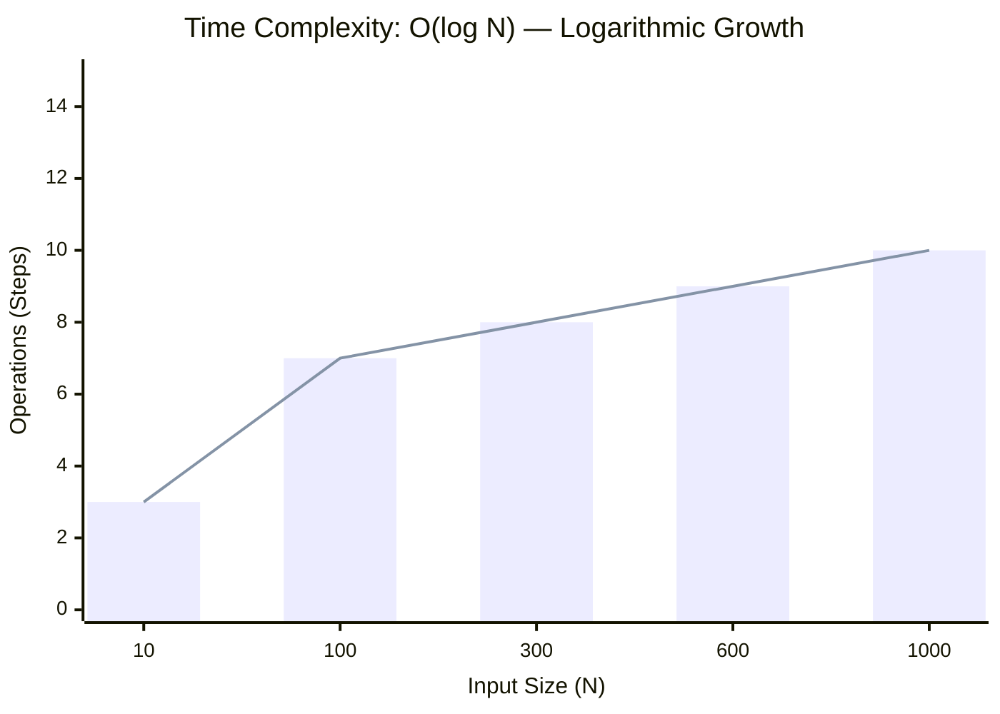
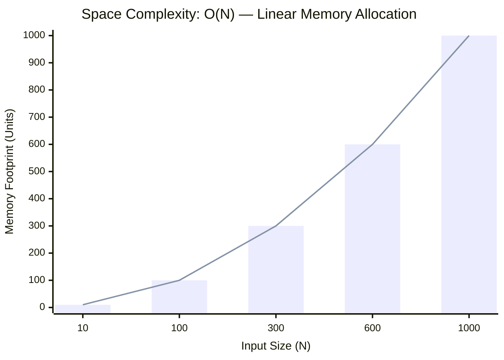

<h2><a href="https://leetcode.com/problems/find-first-and-last-position-of-element-in-sorted-array/submissions/2169505263/">Find First and Last Position of Element in Sorted Array</a></h2><h3>Medium</h3>

Given an array of integers <code>nums</code> sorted in non-decreasing order, find the starting and ending position of a given <code>target</code> value.

If <code>target</code> is not found in the array, return <code>[-1, -1]</code>.

You must&nbsp;write an algorithm with&nbsp;<code>O(log n)</code> runtime complexity.

&nbsp;

<strong class="example">Example 1:</strong>

<pre><strong>Input:</strong> nums = [5,7,7,8,8,10], target = 8
<strong>Output:</strong> [3,4]
</pre>
<strong class="example">Example 2:</strong>

<pre><strong>Input:</strong> nums = [5,7,7,8,8,10], target = 6
<strong>Output:</strong> [-1,-1]
</pre>
<strong class="example">Example 3:</strong>

<pre><strong>Input:</strong> nums = [], target = 0
<strong>Output:</strong> [-1,-1]
</pre>

&nbsp;

<strong>Constraints:</strong>

<ul>
	<li><code>0 &lt;= nums.length &lt;= 105</code></li>
	<li><code>-109&nbsp;&lt;= nums[i]&nbsp;&lt;= 109</code></li>
	<li><code>nums</code> is a non-decreasing array.</li>
	<li><code>-109&nbsp;&lt;= target&nbsp;&lt;= 109</code></li>
</ul>

### 📊 Submission Statistics
- **Language:** `cpp`
- **Runtime:** `0 ms`
- **Memory:** `N/A`
- **Submission Date:** Sun, 11 Oct 2026 17:18:20 GMT

---

### 💡 Approach & Complexity Analysis
#### 🧠 Intuition & Algorithmic Strategy
- **Approach:** Monotonic search space reduction via binary search pointers.
- **Flow:**
  1. Initialize state variables and inspect base constraints.
  2. Iterate through input elements, maintaining current progress and boundaries.
  3. Return the calculated result satisfying problem criteria.

#### ⏱️ Complexity Analysis
- **Time Complexity:** $\mathcal{O}(\log N)$ — *Logarithmic range reduction halving the search space each step.*
- **Space Complexity:** $\mathcal{O}(N)$ — *Auxiliary lookup table or dynamically allocated buffer storing input elements.*

#### 📈 Time Complexity Graph (Operations vs Input Size $N$)

#### 📦 Space Complexity Graph (Memory Footprint vs Input Size $N$)

---
*Auto-synced with [LeetGitSyncPro](https://synccode-pro.pages.dev) & [DSATracker](https://dsatracker.in)*
